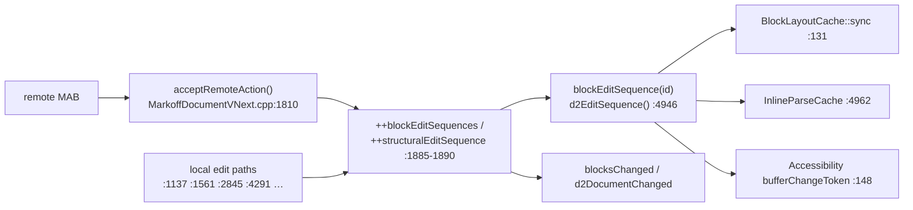

# Markoff widget evaluation — 2026-10-19

Read-only evaluation of the whole widget family against the current tree, the
active board, and the docs. No code changed. Verification run today: offscreen
`scripts/run-tests.sh` **98/98 passed in 30.60 s** (STATUS.md's "95/95" latest
line is stale; the embedded-renderer "98/98" line is the current truth).

## Headline

The widget is in better shape than the task list suggests. Waves 1–2 landed
clean, the parser and canvas arcs are closed, and the embed plugin path works
end-to-end. The real problems are **documentation rot and one obsolete blocker**:
the board parks M13/M18 behind a cache-key hazard that the 2026-10-17 core port
already fixed, citing symbols (`applyRemoteOps`, `bufferProxy`) that no longer
exist. Roughly a day of doc corrections plus one regression test reopens two
M-sized perf rows.

## Tree map

| Leaf | LOC (excl. vendor) | Test files | Role | State |
|---|---|---|---|---|
| `markoff-core` | 17 953 | 44 | document, undo, sessions, find, themes, `MarkdownView` base | solid; M13/M18/M27.4 open |
| `markoff-canvas` | 15 643 | 2 | primary block-projection editor | production arc closed; M37 open |
| `markoff-collabtext-vnext` | 11 552 | 0 | provider-backed engine adapter | works; **no own tests** |
| `markoff-parser` | 6 638 | 14 | tree-sitter + frontmatter | Wave-1 rows verified solid |
| `markoff-styled` | 5 985 | 17 | inline-styled view (frozen, bug-fix only) | M7 half-present |
| `markoff-source` | 2 700 | 10 | source view (frozen, bug-fix only) | stable |
| `markoff-embed` | 665 | 2 | embed contract runtime + backends | skeleton + math only |
| `markoff-text-units` | 126 | 0 | UTF-8↔UTF-16 boundary helpers | thin, untested, mis-shelved |

Vendored: `rapidyaml`, `jkqtmathtext`. Apps: `markoff-canvas-app`,
`markoff-styled-app`, `markoff-source-app`, `markoff-collab-testapp`.

## What's good (verified today)

- **Suite is green and honest.** 98/98 in 30.60 s, offscreen, today. Provider
  conformance (`markoff_provider_backed_document_test`, 30.6 s of the total)
  and two-replica convergence are real tests, not wiring checks.
- **Edit-sequence invariants hold.** Every local mutation path in
  `MarkoffDocumentVNext.cpp` bumps `blockEditSequences` / `structuralEditSequence`
  (:1137, :1561, :1784, :1885, :2845, :2989, :3129, :3285, :3437, :3935, :4291),
  and `d2EditSequence()` (:4946) sums them. Caches keyed on these are sound.
- **Remote application maintains those invariants.**
  `acceptRemoteAction` (:1810) text-diffs before/after and bumps per-block
  sequences (:1885-1890) plus the structural sequence, then emits
  `blocksChanged`/`d2DocumentChanged`. Two-replica merge is tested
  (`tst_markoff_document.cpp:379-406`).
- **Parser hardening (Wave 1) is real.** `std::call_once` frontmatter
  (`Document.cpp:402-414`), validity-gated accessors, UTF-8 validation in
  `Utf8OffsetMap.h`, complete-fence rule (`Document.cpp:44-60`).
- **Canvas embed path works end-to-end.** Contract v2
  (`CodeBlockProcessor.h:14-48`), runtime with LRU + thread pool + rasteriser,
  math backend via jkqtmathtext, canvas paints `embedImage`
  (`View.cpp:5874-5886`), tested offscreen (`tst_canvas_render.cpp:263-328`).
- **View-leaf lifetime bugs are fixed.** M8/M20/M21/M23/M24/M25 all landed with
  tests; document-under-live-view deletion no longer segfaults.

## What's bad

1. **The M13/M18 blocker is obsolete (highest-value finding).**
   `docs/queue.md:96-104` (written 2026-09-29, a11y arc A3.4) claims
   `blockEditSequence` does not bump on remote edits, names `applyRemoteOps`
   and `bufferProxy`, and the triage board's "Blocked on an unreliable key"
   section (2026-10-19) builds on it. All three references are dead: the remote
   path is `acceptRemoteAction`/`routeRemoteAction` (rewritten in `abf65566`,
   2026-10-17), `bufferProxy` has zero hits in `libs/`, and the remote bump
   exists. The board parks two M-sized perf rows behind a fixed problem.
   Residual risk: no test pins *remote-bumps-sequence* specifically
   (`tst_foundation_edit_sequence` covers local monotonicity only) — one test
   closes the gap.
2. **Docs contradict the tree in five places** (details below): README task
   list, README layout table, repo `AGENTS.md` wave status, `queue.md` header,
   and `docs/d-arc` "live" status.
3. **`markoff-collabtext-vnext` has 11.5k LOC and zero own test files.** Its
   coverage arrives indirectly through core tests and the testapp; the router,
   streams, and quarantine paths deserve direct tests.
4. **M7 is a feature-shaped half-implementation inside a frozen leaf.**
   `FormatPass.h:21` reads only `fontScale`; `StyleApplier.cpp:39` compares
   theme pointers; `Theme.h` has no `operator==`; `computeBlockHash:217` omits
   theme — so even a value-equality fix would not restyle. Hardcoded colors
   (`FormatPass.cpp:113`).
5. **`reparse()` has zero production callers** (`TreeSitterParser.cpp:239`;
   only `tst_parser_validity.cpp:159` calls it). M31's API half is done; the
   caller half does not exist.
6. **Embed leaf is a skeleton with one real engine.** Only fake + math
   backends; mermaid still runs on the legacy `MermaidRenderer` seam
   (`BlockLayoutCache.cpp:478-486`); `engineDescription` returns
   `"<lang> (embed contract N)"` instead of a backend name; `Scene` kind is
   declared-unimplemented.
7. **Smaller rot:** styled link hover's per-block re-walk on every document
   change — **DONE** `b563e624` (cache keyed on the block's edit sequence +
   structural sequence); source's session model (owns internally)
   differs from styled's (externally set) with no documented rationale;
   `markoff-text-units`' header ships under `markoff/core/` while CMake calls
   the target `Markoff::TextUnits`.

## What's unfinished, and the gate on each

| Item | Gate | Note |
|---|---|---|
| M13 cached flat view | **DONE** `31b3152b` — 1515 → 0.40 µs/op; typing path unchanged (publication dominates) |
| M18 paste/removal row index | **DONE** `31b3152b` — 50-block paste 879–1020 → 554–588 ms |
| M31 caller-side edit tracking | binding must record byte edits | API ready, no caller |
| M16 debounce half | UI-behaviour decision | controller is synchronous by contract |
| M7 styled theme | explicit exception to bug-fix-only rule | three-part change, hash fix not optional |
| M37 canvas card mode | documented embedded mode + scroll ownership | M38/M39 answers already permit it |
| M26 + M27 item 4 | packaging decision | latent on this toolchain |
| M12 retention | policy decision + multi-doc soak | GC stays disabled by rule |
| M11 enum disposition | **dispositioned 2026-10-19:** keep the enum values, keep refusing loudly, implement later as a named feature (recorded on the triage board) |
| Embedded renderers Phases 2–4 | one named backend at a time | mermaid/graphviz/pikchr/… per `docs/research/mermade-and-others.md` |
| Orca manual a11y pass | user request + `--direct` permission | deferred 2026-09-30 |
| Wave 0 reply | send decision | written, unsent |

## What the docs ignore or get wrong

| Doc | Problem |
|---|---|
| `README.md:55` | names the **closed** CollabText adoption board as "the task list"; the open-asks triage board is current |
| `README.md:29-35` | layout table omits `markoff-embed` and `markoff-text-units`, both wired at root `CMakeLists.txt:93-94` |
| repo `AGENTS.md` | "a seven-wave order, no wave started" — Waves 1–2 completed 2026-10-19 |
| `docs/queue.md:3` | header still points at the CollabText board as current work |
| `docs/queue.md:96-104` | the obsolete M13/M18 blocker (dead symbols, fixed mechanism) |
| `docs/d-arc/d-arc-status.md:1` | calls itself "the live status" of an arc closed 2026-05-08 |
| `docs/STATUS.md` | latest-verification line says 95/95; today's run is 98/98 |
| `mermade-and-others.md` | 442-line external renderer survey untracked at repo root; the embed plan says file it under `docs/research/` |
| leaf `CLAUDE.md`s | `markoff-embed` has none; canvas's list omits `tst_canvas_vnext_session_positions`; `InputPredicate.cpp` (Qt upstream port) is on no board |

Off-board code facts worth a row somewhere: styled link cache resets wholesale
on `d2DocumentChanged` (no per-block dirtying); source `applyParagraphMargins`
reconnects on every `d2DocumentChanged` with no change gate
(`Editor.cpp:174-176`); vnext `ReferenceProviderTestHooks.h` is an undocumented
test-only seam.

## Why the blocker matters (mechanism)

Every cache consumer keys off the same token, and the token advances on remote
application since `abf65566`. The 2026-09-29 queue note described the pre-port
document.

## Recommended order

1. **Doc correction commit** (no code): queue.md blocker note, triage
   "Blocked" section, repo AGENTS.md wave status, README task list + layout
   table, STATUS verification line, file `mermade-and-others.md` under
   `docs/research/` and commit it.
2. **One regression test**: remote action bumps `blockEditSequence` /
   `d2EditSequence` (two-replica, in `tst_markoff_document.cpp` next to the
   existing convergence cases).
3. **Start M13** (cached flat view + block-offset vector), then M18 — both now
   unblocked, both M-sized.
4. **M11 enum decision** — smallest open P1; closes a row outright.
5. **Send the Wave 0 reply** — written, awaiting only the send decision.
6. Then the decision-gated rows (M7, M37, M26/M27.4, M12) in whatever order the
   user rules on them; Graffodil Waves stay in that repo.

## Actions taken on this evaluation (2026-10-19)

Step 1 landed (`6f112d6f`): the doc-correction commit fixed every stale
pointer above (queue.md header + blocker note, triage board "Blocked"
section + close-out table + Wave 3 + M13 anchor, repo `AGENTS.md` wave
status, README task list + layout table, d-arc archived marker, STATUS
verification line) and filed `mermade-and-others.md` under
`docs/research/`. M11's disposition is recorded on the triage board: keep
the enum values, keep refusing loudly, implement as a named feature later.

Step 2–4 landed (`31b3152b`): the remote-bumps-sequence regression test,
M13 (flat-view cache + binding sep index) and M18 (list-insert identity),
plus a fix the cache exposed — `compensateReplacementAction` did not
advance the edit sequences on multi-group undo/redo. Numbers and the two
new rows they uncovered (action-publication cost; jkqtmathtext exit-time
UAF) are on the board's Wave 3 section and close-out table. M17's
remaining half landed as `b563e624`.
