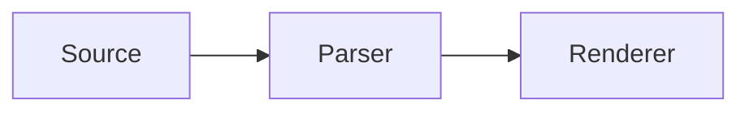

# Native renderers for extended Markdown: a survey for C++ and Qt

The situation has improved considerably. As of October 2026, there are multiple genuine, open-source, non-JavaScript implementations of Mermaid, including one in C++, several in Rust, and another in Swift. Some are surprisingly comprehensive.

That changes the prospects for building a native Qt Markdown renderer. You no longer necessarily have to embed a browser, ship a JavaScript interpreter, or recreate Mermaid yourself.

There is an important distinction, however, between three kinds of software:

- Native renderer: Parses a language and renders it using C, C++, Rust, or another compiled language. This is what you're principally looking for.
- Native-hosted renderer: Written in Java, Python, or another non-JavaScript language, and runs entirely locally. It can work without a browser, although integration may require an external runtime or process.
- Disguised web renderer: A C++ or Rust wrapper around JavaScript, V8, QuickJS, Chromium, or WebAssembly code originating from a JavaScript implementation. This does not satisfy your requirements.

I'll distinguish these throughout. I'll also separate compatibility with an established markup language from having a renderer for the same general kind of diagram. Those are not interchangeable.

## 1. The markup ecosystem worth supporting

Markdown itself has no universal standard for embedded diagram languages. Applications typically recognize fenced code blocks such as:

````

````

or use extensions such as `$...$`, `$$...$$`, directives, callouts, and specialized attachments.

Here is the inventory I would use when designing a general-purpose renderer.

| Family                          | Languages and formats                                                         | Typical uses                               |
| ------------------------------- | ----------------------------------------------------------------------------- | ------------------------------------------ |
| General diagrams                | Mermaid, Graphviz DOT, D2, PlantUML, Pikchr, Nomnoml                          | Flowcharts, graphs, architecture           |
| Sequence and process diagrams   | PlantUML, Mermaid, seqdiag, actdiag, BPMN                                     | Protocols, workflows, messaging            |
| Scientific mathematics          | LaTeX math, KaTeX syntax, MathJax syntax, AsciiMath                           | Equations and notation                     |
| Technical illustration          | TikZ/PGF, PSTricks, Typst, Asymptote                                          | Mathematical figures, publication graphics |
| Charts and visualization        | Vega, Vega-Lite, Gnuplot, Plotly specifications, Chart.js-style data          | Data visualization                         |
| Timelines and planning          | Mermaid Gantt, PlantUML Gantt, D2, Markwhen                                   | Schedules, chronologies                    |
| Electronics and timing          | WaveDrom, Bytefield, WireViz, Symbolator                                      | Digital signals, buses, wiring             |
| Textual graphics                | Ditaa, Svgbob, ASCII art, Unicode box diagrams                                | Terminal-style diagrams                    |
| Software and database models    | DBML, ERD, Structurizr DSL, C4-PlantUML                                       | Schemas, architecture                      |
| Mind maps and drawing documents | Mermaid mindmaps, Markmap, Excalidraw, diagrams.net                           | Knowledge maps, visual notes               |
| Typeset document fragments      | Typst, LaTeX, AsciiDoc, reStructuredText                                      | Rich technical content                     |
| Specialized scientific formats  | Chemfig, mhchem, SMILES, LilyPond                                             | Chemistry, molecular notation, music       |
| Code highlighting               | Tree-sitter grammars, TextMate grammars, Pygments-style languages             | Syntax-highlighted source                  |
| Markdown extensions             | GitHub alerts, Obsidian callouts, admonitions, tabsets, footnotes, task lists | Structured prose                           |
| Interactive or computed blocks  | Jupyter-style cells, executable Python/R, embedded HTML, JSX/MDX              | Live or computed content                   |

A useful existing reference is the [Obsidian Kroki plugin](https://github.com/gregzuro/obsidian-kroki?utm_source=chatgpt.com), which exposes many diagram languages using fenced Markdown blocks. Its catalogue is a good starting point for discovering formats, even though its usual server-backed rendering model isn't suitable for your native-only requirement.&#x20;

[image](https://www.google.com/s2/favicons?domain=https://community.obsidian.md\&sz=32)

Obsidian Plugin

+1


Not all of these are equally popular. Mermaid, LaTeX mathematics, Graphviz, PlantUML, and syntax-highlighted code are the core interoperability targets. D2, Pikchr, Typst, and the scientific and engineering languages are valuable secondary targets.

## 2. Mermaid: the biggest breakthrough

Mermaid is the most important discovery in this survey. I found five independent-looking native implementation projects or families, although some share components or are wrappers of the same underlying Rust engines.

[A picture is worth a thousand words. Especially after a meeting.](https://images.openai.com/static-rsc-4/vIcEeWUwA_Cw7mA58njKR_d8MdmLSFhOepa2oKSIuaxYPEKttfR-MB_G7mj3C2tgiItgNVOj4hBWQwvruxDgBzV0S8hmHfEkIA0kHAT3htKudwv6OzGOO6MKzU5xV6-u01K6EDdZigY7jJ4SXTdIDdaQH7JzTm64nKMFEk5BKbM?purpose=inline)

[Merman](https://github.com/Latias94/merman?utm_source=chatgpt.com) — Rust

Top candidate

MIT / Apache-2.0. Native parser, layout and SVG renderer, with no JavaScript engine. Its current README describes 37 built-in diagram types, typed semantic models, diagnostics, and optional raster output. It is already used as a Mermaid backend in Zed.&#x20;

[image](https://www.google.com/s2/favicons?domain=https://github.com\&sz=32)

GitHub


[mermaid-rs-renderer](https://github.com/1jehuang/mermaid-rs-renderer?utm_source=chatgpt.com) — Rust

MIT. A competing native implementation reporting support for 23 types. Particularly interesting is its optional vector Scene API, exposing drawing commands instead of forcing you to embed SVG. That could make direct `QPainter` integration possible.&#x20;

[image](https://www.google.com/s2/favicons?domain=https://github.com\&sz=32)

GitHub


[mermaid-cpp](https://github.com/mermaid-cpp/mermaid?utm_source=chatgpt.com) — C++23

A direct C++ reimplementation using CMake, `canvas_ity`, `fmt`, and `stb_image`. This is the one to examine if avoiding a Rust toolchain is essential. However, the repository has very little adoption (three GitHub stars when checked), and I could not establish a comprehensive compatibility matrix or confirmed license from the surfaced material. Treat it as experimental, not a proven drop-in replacement.&#x20;

[image](https://www.google.com/s2/favicons?domain=https://github.com\&sz=32)

GitHub


[MermaidKit](https://github.com/2389-research/MermaidKit?utm_source=chatgpt.com) — Swift

A substantial Swift implementation reporting 30 diagram types. It provides native layout, SVG export, and a platform-neutral scene representation across a C ABI. It supports Linux using Cairo/FontConfig as well as Apple platforms. An intriguing option for a Qt integration, despite the Swift dependency. Its license requires a separate check before adoption.&#x20;

[image](https://www.google.com/s2/favicons?domain=https://github.com\&sz=32)

GitHub


[Mermaider](https://github.com/nullean/mermaider?utm_source=chatgpt.com) — C#/.NET

Pure managed .NET, with no browser or JavaScript, claiming coverage of 24 major diagram types. Includes a Sugiyama graph layout engine and native AOT support on Linux, macOS, and Windows. Interesting if you want a compiled helper, though less convenient than a native C ABI for Qt. License not conclusively verified in my search.&#x20;

[image](https://www.google.com/s2/favicons?domain=https://github.com\&sz=32)

GitHub


For Mermaid, I would begin with Merman and mermaid-rs-renderer, rather than the C++ project. Their documentation and breadth make them more immediately credible as an implementation foundation.

In particular, Merman attempts to reproduce Mermaid semantics rather than merely render vaguely similar-looking graphs. Its README states it tracks Mermaid 12.1.0, although it explicitly warns that browser text measurement, HTML labels, and some geometry can differ.

The distinction is important because Mermaid is not really a single diagram language. It is a family of sublanguages with separate grammars, including:

- Flowcharts
- Sequence diagrams
- Class diagrams
- State machines
- ER diagrams
- Gantt charts
- Mind maps
- Git graphs
- Timelines
- Journey diagrams

* Sankey diagrams
* Pie charts
* Quadrant charts
* XY charts
* C4 architecture
* Kanban boards
* Requirement diagrams
* Packet diagrams
* Block diagrams
* Treemaps

A renderer covering twenty or thirty of these effectively replaces a substantial collection of independent Markdown plugins.

One additional repository, [MohammadRaziei/mmdr](https://github.com/MohammadRaziei/mmdr?utm_source=chatgpt.com), packages Merman and mermaid-rs-renderer behind Python bindings. It is MIT-licensed and browser-free but is not another independent rendering engine.&#x20;

[image](https://www.google.com/s2/favicons?domain=https://github.com\&sz=32)

MohammadRaziei/mmdr · GitHub


## 3. Established native engines for the other major languages

These aren't hypothetical agent-generated ports. Most are established rendering engines that you can integrate now.

| Format                  | Project / source                                                                    | Implementation | License                       | Qt suitability                              |
| ----------------------- | ----------------------------------------------------------------------------------- | -------------- | ----------------------------- | ------------------------------------------- |
| Graphviz DOT            | [Graphviz](https://gitlab.com/graphviz/graphviz?utm_source=chatgpt.com)             | C              | EPL-2.0                       | Excellent; embeddable libraries             |
| Pikchr                  | [Pikchr](https://pikchr.org/?utm_source=chatgpt.com)                                | C89            | 0BSD                          | Excellent; tiny C integration               |
| D2                      | [D2](https://github.com/terrastruct/d2?utm_source=chatgpt.com)                      | Go             | MPL-2.0                       | Good through local helper or library bridge |
| PlantUML                | [PlantUML](https://github.com/plantuml/plantuml?utm_source=chatgpt.com)             | Java           | GPL and alternatives          | Good through local process; JVM required    |
| Typst                   | [Typst](https://github.com/typst/typst?utm_source=chatgpt.com)                      | Rust           | Apache-2.0                    | Excellent output; FFI or subprocess         |
| LaTeX math              | [MicroTeX](https://github.com/NanoMichael/MicroTex?utm_source=chatgpt.com)          | C++17          | MIT                           | Excellent; explicit Qt support              |
| TeX / LaTeX             | [Tectonic](https://github.com/tectonic-typesetting/tectonic?utm_source=chatgpt.com) | Rust / C       | MIT core, mixed dependencies  | Good; heavyweight                           |
| Gnuplot                 | [Gnuplot](https://github.com/gnuplot/gnuplot?utm_source=chatgpt.com)                | C              | Gnuplot-specific free license | Good via process                            |
| Math + full typesetting | [Typst](https://github.com/typst/typst?utm_source=chatgpt.com)                      | Rust           | Apache-2.0                    | Good for complex fragments                  |

The licenses above are based on the projects' published licensing information, not a complete dependency audit. Graphviz now explicitly identifies EPL-2.0, having changed from its earlier CPL license in March 2026. PlantUML offers a choice of GPL, LGPL, MIT, Apache and other licensing terms for its code.&#x20;

[image](https://www.google.com/s2/favicons?domain=https://www.graphviz.org\&sz=32)

Graphviz

+7


### Three exceptionally good fits for Qt

[graphviz 的绘图布局 - 蝈蝈俊 - 博客园](https://images.openai.com/static-rsc-4/DcOSyFcdg0oUsaGtAb1ZEh0vG-PU4Rlvs-yRYZtT_Vtoyrryr-DnpDKAzJZCHLXcb5l3o7hhnTkHJcfDvkcEq5BEMTlTkSj94cvl89rcZ9_Jv5U3FjmznYQk7vn8oE3il5SPFg03_HBjBDy6SIHBnZQOe8jAbU70D-49o3n5qkA?purpose=inline)

Graphviz

Written in C, exposes library interfaces, and offers multiple layout algorithms: `dot`, `neato`, `fdp`, `sfdp`, `circo`, and `twopi`.

You can integrate its `libgvc` layout and output pipeline directly, rather than launching `dot`. This is the mature solution for directed graph layout.

[IntelliPikchr - IntelliJ IDEs Plugin | Marketplace](https://images.openai.com/static-rsc-4/HvCIUTlqmiewSwPe5xzZAe36DWOWK2GUtxz-beSZhTCikhx2SrFhdtDAQ_6jQe0GhFDwb6K88pTwZ1hp5TrihxbtmvePrHAWuANPLyNdDlf67y1EadWqETn9BopkD25m1UMAaXo7bHV6EB-mBF3ecSzthS97JLe3FlYqWZrgZOI?purpose=inline)

Pikchr

A particularly elegant project from D. Richard Hipp, creator of SQLite and Fossil. The parser and renderer can be compiled into one self-contained C89 file, producing SVG. Zero-Clause BSD licensing means remarkably little integration friction.&#x20;

[image](https://www.google.com/s2/favicons?domain=https://pikchr.org\&sz=32)

pikchr.org

+1


[Typst 模式 | 知乎 Obsidian 插件](https://images.openai.com/static-rsc-4/VOC2pfCZxiKFGZAZUAlsdpbcVYeGkjfzboziRLLSE83yL8MPsKfyqJkBUUws-fJL-PGFe5wYv-oHzOx_1epXyQmE6isshb-R9y_mo3MGtFhuaK4C78eTc8hFOBQRvhOiRfwcNr_bGPW2Fgsb13xpF8t2RTxdYcKcy7r4J6eUq9s?purpose=inline)

MicroTeX

A purpose-built mathematical expression renderer, not a complete TeX distribution. Its source includes Qt support controlled by the CMake option `-DQT=ON`. It is C++17 and MIT-licensed, excluding separately licensed fonts and resources.&#x20;

[image](https://www.google.com/s2/favicons?domain=https://github.com\&sz=32)

GitHub

+1


Of all the projects found, MicroTeX is probably the most straightforward immediate addition to a Qt renderer, assuming you're not already satisfied with your mathematics solution.

Pikchr is the other unusually attractive one. Its original design explicitly anticipates fenced Markdown integration, and it does not require a special compiler runtime or sprawling dependency graph.

## 4. Lesser-known diagram languages with native renderers

Some of these are particularly relevant to technical writing, engineering, and documentation.

| Language                | Native implementation                                                                         | License          | Notes                                                                     |
| ----------------------- | --------------------------------------------------------------------------------------------- | ---------------- | ------------------------------------------------------------------------- |
| WaveDrom                | [wavedrom-rs](https://github.com/coastalwhite/wavedrom-rs?utm_source=chatgpt.com)             | MIT              | Rust implementation, close to original WaveJSON compatibility, SVG output |
| Svgbob                  | [svgbob](https://github.com/ivanceras/svgbob?utm_source=chatgpt.com)                          | Apache-2.0       | Rust, ASCII/Unicode diagrams to SVG                                       |
| Blockdiag               | [blockdiag](https://github.com/blockdiag/blockdiag?utm_source=chatgpt.com)                    | Apache-2.0       | Python renderer, no browser required                                      |
| Seqdiag                 | [seqdiag](https://github.com/blockdiag/seqdiag?utm_source=chatgpt.com)                        | Check repository | Python-based sequence diagrams                                            |
| Actdiag                 | [actdiag](https://github.com/blockdiag/actdiag?utm_source=chatgpt.com)                        | Apache-2.0       | Python-based activity diagrams                                            |
| Nwdiag                  | [nwdiag](https://github.com/blockdiag/nwdiag?utm_source=chatgpt.com)                          | Apache-2.0       | Python-based network diagrams                                             |
| LilyPond                | [LilyPond](https://github.com/lilypond/lilypond?utm_source=chatgpt.com)                       | GPL-3.0-or-later | Full music engraving system                                               |
| Graphviz-compatible DOT | [MermaidKit DOT frontend](https://github.com/2389-research/MermaidKit?utm_source=chatgpt.com) | Verify           | Alternate native DOT parser, though not full Graphviz parity              |

These are real implementations, not proposals. The standout is wavedrom-rs, precisely because it reimplements an established browser-oriented format without JavaScript. Its documentation claims support for the original signal types, groups, arrows, annotations, headers, footers, and configurable skins.&#x20;

[image](https://www.google.com/s2/favicons?domain=https://github.com\&sz=32)

GitHub

+5


WaveDrom example — digital signal timing

[\[설계독학\] \[쉬어가기 7장\] Timing Diagram 을 아름답고 쉽게 만들어봐요. (WaveDrom Tutorial) — 설계독학맛비 (AI FPGA)](https://images.openai.com/static-rsc-4/fD0JEFBEOlMCMOkD-q92d-A-2urIbj-BziYkikU9r-Hpx8uO0zU7q6GfnlXC9qDTtUgOpjLritjt3W3VTMC_vezuujzpEv7iiv_Mcpz51NOrRHVU0z7AHv6IaTzJRjJ2TV2M4_JA-sUNxDrIHU-60Y6yXh84ZWB8EyK5W0-pPRc?purpose=inline)

[aifpga.tistory.com](https://aifpga.tistory.com/entry/%EC%84%A4%EA%B3%84%EB%8F%85%ED%95%99-%EC%89%AC%EC%96%B4%EA%B0%80%EA%B8%B0-7%EC%9E%A5-%EC%95%84%EB%A6%84%EB%8B%A4%EC%9A%B4-Timing-Diagram-%EC%9D%84-%EC%89%BD%EA%B2%8C-%EB%A7%8C%EB%93%A4%EC%96%B4%EB%B4%90%EC%9A%94-wavedrom-%EC%82%AC%EC%9A%A9-%EB%B0%A9%EB%B2%95?utm_source=chatgpt.com)

WaveDrom is especially useful in hardware, protocol, and electronics documentation, where rendering signal transitions from a compact textual description is valuable.

There is also a substantial existing native option for code blocks: [Tree-sitter](https://github.com/tree-sitter/tree-sitter?utm_source=chatgpt.com). Its highlighting library has a C API and works with language-specific grammars and highlight queries. It is an excellent foundation for Qt syntax highlighting and doesn't require JavaScript.&#x20;

[image](https://www.google.com/s2/favicons?domain=https://github.com\&sz=32)

GitHub


## 5. Formats where the native replacement is still missing or uncertain

This is where a genuinely useful free-software development project could be found.

| Language / format         | Situation                                                     | Practical strategy                                           |
| ------------------------- | ------------------------------------------------------------- | ------------------------------------------------------------ |
| Vega / Vega-Lite          | Popular Rust converter still embeds V8 and executes JS        | New native parser + chart renderer, or support a subset      |
| Markmap                   | Markdown-to-mindmap ecosystem is strongly JavaScript-oriented | Convert Markdown AST into a native graph layout              |
| Excalidraw                | Established rendering ecosystem is primarily JS/React         | Parse its JSON scene format and implement Qt painting        |
| diagrams.net / draw\.io   | XML format; rendering normally uses its JS application        | Implement a subset of mxGraph geometries and styles          |
| Plotly JSON               | Major rendering ecosystem is JS-based                         | Translate common traces into native Qt chart primitives      |
| Nomnoml                   | Existing implementation is JS                                 | Native grammar and layout implementation needed              |
| DBML                      | Schema language, with JS-heavy rendering ecosystem            | Parse schema, render via Graphviz                            |
| Markwhen                  | Official parser is TypeScript                                 | Port parser, use native Qt timeline painting                 |
| HTML embedded in Markdown | Arbitrary HTML/CSS is a much larger problem                   | Explicitly support a restricted HTML subset                  |
| JSX / MDX                 | Executable component model, not merely a graphics format      | Declare unsupported, or design a separate component language |

A specific trap is [vl-convert](https://github.com/vega/vl-convert?utm_source=chatgpt.com). Despite being a Rust project distributed as a native application, its own README explains that it embeds Deno/V8 to execute Vega-Lite and Vega's JavaScript implementation. It is offline, but it is not a native reimplementation in the sense you're asking for.&#x20;

[image](https://www.google.com/s2/favicons?domain=https://github.com\&sz=32)

GitHub


Similarly, projects based on QuickJS, such as the default backend of [mermaidx](https://github.com/MohammadRaziei/mermaidx?utm_source=chatgpt.com), aren't native Mermaid ports. They run Mermaid JavaScript inside an embedded interpreter.&#x20;

[image](https://www.google.com/s2/favicons?domain=https://github.com\&sz=32)

GitHub


I did not find a verified complete native drop-in renderer for the other formats in this table during this search. That is not evidence that none exists; it means I would not recommend one without further examination.

### Especially interesting: Excalidraw

[Excalidraw | Webex App Hub](https://images.openai.com/static-rsc-4/ykfUxax2K3y6H4TTbVMZ44DBdJhJOyOwdow7rSdulj5aPzEkeXLE10SYEJ8suR3a9CjxGjTUiyxWPLR3gK08JuIfpscIST8lFyjzVh2723BJDdaCZY6tWvcpUnLuuLWgLog3i2xffarpE5GIxbUdj_RnYbiRpdQYmzJKQGR1J8s?purpose=inline)

[Excalidraw on AWS User Guide | cloudimg](https://images.openai.com/static-rsc-4/NkdkeOAnVdRnbHRC7_r7YE-gRexyrtWj3215HbcCe3z5IkV4wxKJfrT6ByAX6J5teFaRDpEH66ABnSpixT3_Fzn0jptCA_JcFqm0oXjvym6X7zW1l6nkDPM8ZcvgeFtbP_cg7woQyPMkqfJ2NpDxOYuWw_uk_HsNqu7bko0H77I?purpose=inline)

[Why I ditched Lucidchart for Excalidraw the sketchy app that doubled our dev flow | by BuildShift | Medium](https://images.openai.com/static-rsc-4/21ZDA3-ftXw9Vzlhb1iOwwLgJCf1I85E0H-ZRYGL9GWsUNOXNQm40NWyv15QewjfFaZlOjchn8juiVld6PUfjp5OwUWPsxUbhQgbN-TfWPtW3tnzv4Kl_daSAYfAABosK1sfS3IQ4IpDC5bSnuWmJ7QW7PoplCKqoXuBQQBz6kM?purpose=inline)

9

Excalidraw deserves special attention because its document format is fundamentally different from Mermaid.

Mermaid source describes what a diagram should contain, leaving most layout decisions to the renderer. Excalidraw documents contain individual graphical elements and their coordinates. Consequently, an Excalidraw renderer doesn't need to solve a general graph layout problem.

It needs to reproduce a drawing model: rectangles, ellipses, diamonds, paths, text, connectors, transforms, colours, roughness, and layering.

That could be a very satisfying C++/Qt project. Fidelity to the original sketch-like drawing style would be the primary challenge, particularly the hand-drawn appearance and text layout. A basic document viewer is much less daunting than recreating the entire Excalidraw editor.

## 6. How I would integrate all this into a Qt Markdown renderer

I would avoid treating embedded languages as special cases of Markdown or trying to render them as miniature web pages.

Instead, I would make the embedding mechanism general-purpose and give each renderer a very small interface.

One Markdown embedding interface with interchangeable rendering backends. No web view or network service is required.

The parser should identify the fenced block and hand its content to a corresponding registered renderer.

For example:

```

struct RenderRequest {
    QString language;
    QString source;
    QSizeF availableSize;
    QColor foreground;
    QColor background;
    qreal devicePixelRatio;
};

struct RenderResult {
    QByteArray svg;
    QImage image;
    QString error;
    QSizeF intrinsicSize;
};

class EmbeddedRenderer {
public:
    virtual ~EmbeddedRenderer() = default;

    virtual QStringList languages() const = 0;
    virtual RenderResult render(
        const RenderRequest &request) = 0;
};

```

This is deliberately a simplified interface. In a production implementation, I would separate the rendering operation from its result so that large diagrams can be rendered asynchronously and cancelled when their source changes.

There are three good integration methods:

Directly linked C/C++ libraries. Use for Graphviz, Pikchr, and MicroTeX. These offer the cleanest deployment and usually the best opportunities for integrating with your existing Qt types.

Rust libraries behind C ABIs. Use for Merman, wavedrom-rs, svgbob, and potentially Typst. A small exported C interface can accept UTF-8 source and return an SVG buffer plus a corresponding release function. The Qt application never needs to know about Rust ownership or internal types. Avoid unwinding Rust panics across the FFI boundary.

Local executables. Use for PlantUML, Gnuplot, and potentially D2, LilyPond, and heavyweight TeX. `QProcess` provides a sensible initial integration without linking language runtimes into the editor. Here I would add execution limits, a bounded temporary directory, and careful handling of external resources.

For output, SVG is an excellent common denominator. `QSvgRenderer` can draw vector output through `QPainter`, using Qt's normal coordinate and scaling facilities. The caveat is that Qt SVG doesn't implement every conceivable browser SVG feature, so conformance testing matters.

One architectural improvement I would recommend is not to make SVG the only output format. If a renderer exposes native paths, text, and geometry (as mermaid-rs-renderer now does), a native display-list interface would allow you to preserve text selection, hit testing, theme controls, and potentially native interaction.

That's much more interesting than merely converting every diagram to an image.

## 7. Suggested implementation order

Here is the order I would use if the aim were broad compatibility with real Markdown files rather than supporting every exotic language for its own sake.

| Priority | Language            | Engine                    | Integration effort                   |
| -------- | ------------------- | ------------------------- | ------------------------------------ |
| 1        | Mermaid             | Merman                    | Medium: Rust FFI                     |
| 2        | LaTeX mathematics   | MicroTeX                  | Low: native Qt integration           |
| 3        | Graphviz DOT        | Graphviz                  | Low–medium: C API                    |
| 4        | Pikchr              | Pikchr                    | Very low: C89, single-file           |
| 5        | Syntax highlighting | Tree-sitter               | Medium: per-language grammars        |
| 6        | WaveDrom            | wavedrom-rs               | Medium: Rust FFI                     |
| 7        | Svgbob              | svgbob                    | Medium: Rust FFI                     |
| 8        | D2                  | D2                        | Medium: Go binary or FFI             |
| 9        | PlantUML            | PlantUML                  | Low via JVM subprocess               |
| 10       | Typst               | Typst                     | Medium–high: typesetting integration |
| 11       | Excalidraw          | Native Qt implementation  | High: rendering fidelity             |
| 12       | Vega-Lite           | New native implementation | High: chart grammar and layout       |

The effort estimates are relative engineering judgments, not measured implementation times.

For the Markdown layer itself, [MD4C](https://github.com/mity/md4c?utm_source=chatgpt.com) is worth mentioning, even if you already have an established parser. It's MIT-licensed, written in C, and already used by Qt's `QTextDocument` Markdown implementation. It gives you CommonMark-compliant block identification without committing to HTML as the output.&#x20;

[image](https://www.google.com/s2/favicons?domain=https://github.com\&sz=32)

GitHub

+1


## 8. The larger opportunity: a reusable native rendering library

I think there's a meaningful opportunity beyond improving your own Markdown application.

Today, the standard solution to increasingly elaborate Markdown rendering is to quietly turn the viewer into a web browser. The Markdown document becomes an HTML document, then acquires CSS, JavaScript, DOM dependencies, and eventually web application infrastructure.

But the actual job is usually much narrower: recognize a small embedded language, parse it, arrange its elements, and draw them.

A Qt-native Markdown extensions library that bundled or connected the renderers above would be genuinely useful to projects such as KDE Marknote, QOwnNotes, document viewers, desktop publishing programs, and native knowledge-management applications.

The particularly interesting approach would be to separate parsing, layout, and painting:

- The source parser understands Mermaid, DOT, WaveJSON, or another DSL.
- The layout engine computes shapes, nodes, text positions, paths, and edges.
- The painting backend displays these through Qt, with output to SVG/PDF where desired.

In that design, SVG becomes one possible serialization format, not the architecture itself.

This also provides an obvious route to rendering diagrams with selectable text, accessible descriptions, live editing, interactive elements, and consistent light/dark theme handling without copying the web's CSS and DOM models.

### Where agentic programming could make a contribution

The new Mermaid projects provide compelling evidence that fairly complicated renderers can now be reimplemented outside their original JavaScript environments. I cannot attribute their development speed specifically to coding agents without evidence from their maintainers, but several demonstrate the kind of ambitious reimplementation you're describing.

The most valuable contribution might not be yet another Mermaid renderer. Merman already looks like a serious answer to that problem.

I would concentrate on two things:

1. Building the portable native renderer interface, then integrating the existing free engines.
2. Identifying remaining languages with no satisfactory native implementation, especially Excalidraw's scene format, Markmap, and Vega-Lite.

One final caution: for real-world documents, renderer fidelity is not only about recognizing syntax. Fonts, layout measurements, text wrapping, edge routing, theming, and embedded SVG features often account for the visible differences. Build a corpus of actual diagrams and compare outputs as you integrate each engine.

My strongest recommendation is to evaluate Merman, MicroTeX, Graphviz, and Pikchr first. Together they would give your Qt application a substantial set of native capabilities. They also represent four quite different design approaches to parsing and rendering, making them useful references for a general framework.

And among the more unusual discoveries, I would look closely at the `SceneCommand` API in mermaid-rs-renderer. That is almost exactly the architectural direction I'd want: the embedded language produces drawing instructions, and Qt remains completely in charge of the display.
